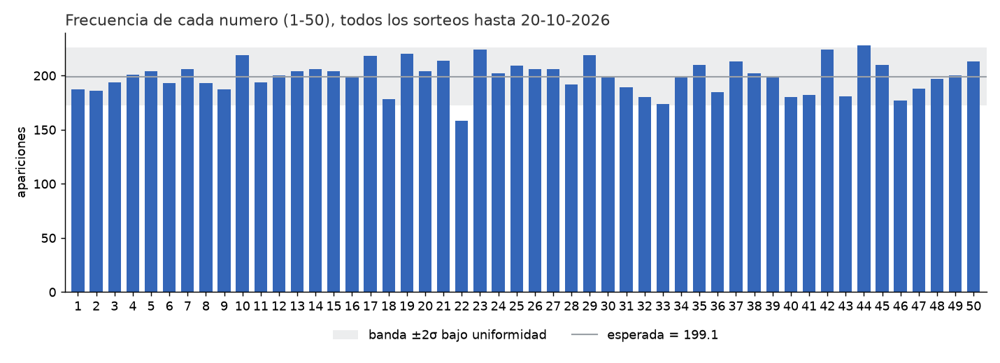
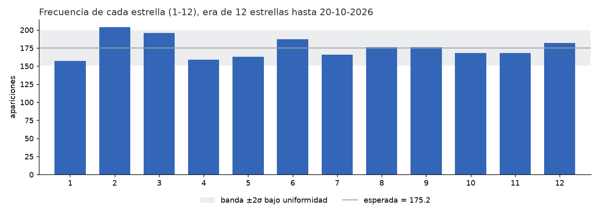
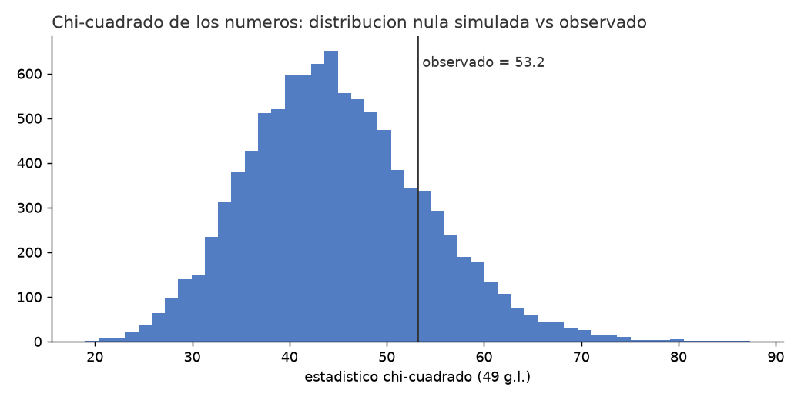
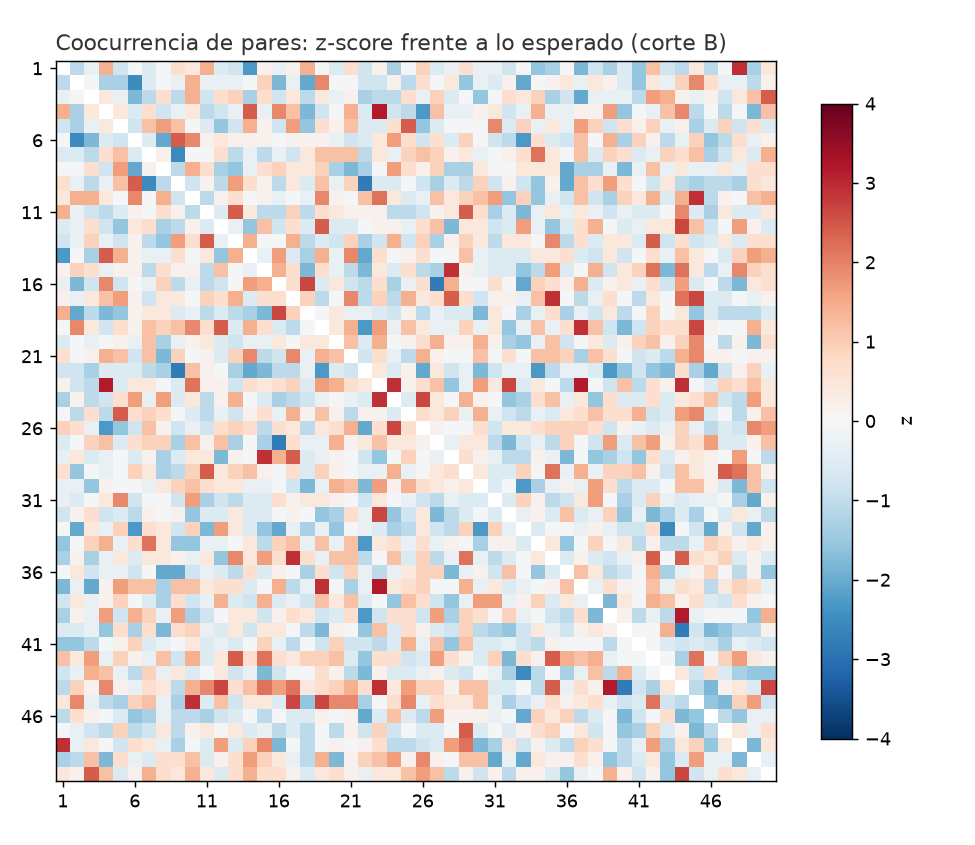

# Estudio estadistico reproducible de Euromillones (corte 20-10-2026)

Generado el 2026-10-21T18:51:48 por `scripts/estudio_euromillones.py` con semilla `20261020`,
`10000` replicas Monte Carlo y `10` combinaciones.

## 0. Aviso previo

Euromillones es un sorteo fisico con extraccion sin reemplazo de 5 bolas entre 50 y 2 estrellas entre 12.
Cada una de las 139,838,160 combinaciones posibles tiene exactamente la misma
probabilidad en cada sorteo, con independencia del pasado. **Este estudio no predice nada**: describe el
historico, contrasta si es compatible con un sorteo uniforme e independiente (lo es) y demuestra con datos
que las etiquetas "numero caliente" o "numero frio" no tienen valor predictivo. Las combinaciones del
apartado 7 son equiprobables a cualquier otra; solo estan diversificadas entre si.

## 1. Fuente y verificacion

- Operador oficial: Francaise des Jeux (FDJ), pagina "Historique EuroMillions - My Million"
  (`https://www.fdj.fr/jeux-de-tirage/euromillions-my-million/historique`), seis ZIP descargados el 2026-10-21
  desde `https://www.sto.api.fdj.fr/anonymous/service-draw-info/v3/documentations/...` (copia en `data/raw/`).
- El API de Loterias y Apuestas del Estado (`loteriasyapuestas.es/servicios/buscadorSorteos`) devolvio HTTP 403 a
  peticiones automatizadas, por lo que no se uso como fuente primaria. Los numeros ganadores son los mismos en
  todos los paises participantes (sorteo unico en Paris). Contraste manual el 2026-10-21 en la pagina oficial de
  resultados de SELAE (`https://www.loteriasyapuestas.es/es/resultados/euromillones`): los 27 sorteos mostrados
  (21-07-2026 a 20-10-2026) coinciden con el fichero FDJ; el ultimo, martes 20-10-2026, es 09-15-16-37-43 con
  estrellas 07-10 en ambas fuentes.
- Manifiesto de descarga:
- `01_euromillions_2004-02_2011-05.zip` -> `euromillions.csv` (378 filas), SHA-256 `c8cd66ae98864000cfee02e47021b96896095b5971657fcae582bf752cbdb152`
- `02_euromillions_2011-05_2014-02.zip` -> `euromillions_2.csv` (286 filas), SHA-256 `fe7a4bad4fdadc86776e8a88c45057a9977e85521a3580607beec83a8e2e25cd`
- `03_euromillions_2014-02_2016-09.zip` -> `euromillions_3.csv` (276 filas), SHA-256 `bd35c6fed317f0dbb8487c7aeda0d3a40a5754ebbbf5a92e4670f1cb1ee80101`
- `04_euromillions_2016-09_2019-02.zip` -> `euromillions_4.csv` (253 filas), SHA-256 `6d84073487efa6691d61aa1781b0cc45d329c03fdb7d775a3ce77e2a337dcf55`
- `05_euromillions_2019-03_2020-02.zip` -> `euromillions_201902.csv` (97 filas), SHA-256 `90036089e5eedbf86c6298105134c8fe80f5a80d29c76e5fbcc20eaeaadd6c82`
- `06_euromillions_2020-02_2026-10.zip` -> `euromillions_202002.csv` (701 filas), SHA-256 `a80cd8db4eeb05169849786a2234f64b7b66c60f63a3ba71a93c893ebfa95904`
- Validacion automatica: 1991 sorteos leidos, del 2004-02-13 al
  2026-10-20; sin fechas duplicadas; bolas en 1-50 sin repeticion; estrellas dentro del maximo
  de su era (9 hasta 06-05-2011, 11 hasta 23-09-2016, 12 desde 27-09-2016); columna de control de la propia FDJ
  coincidente en el 100 % de los sorteos. Problemas detectados: ninguno.
- Dataset limpio: `data/euromillones_historico.csv` (una fila por sorteo, bolas ordenadas y en orden de salida).

## 2. Cortes temporales

| corte | sorteos | sorteos con 12 estrellas |
|---|---|---|
| A: hasta 20-10-2023 inclusive | 1678 | 738 |
| B: hasta 20-10-2026 inclusive (actual) | 1991 | 1051 |
| ventana: 21-10-2023 a 20-10-2026 | 313 | 313 |

Las frecuencias de estrellas se calculan por era reglamentaria; mezclar eras sesgaria las estrellas 10, 11 y 12.

## 3. Frecuencias

Esperada por numero en B: 199.1 apariciones (1991 x 5 / 50). Desviacion tipica bajo uniformidad: ~13.4.

### 3.1 Numeros, corte B (ordenados por frecuencia; ficheros completos en `output/frecuencias_numeros.csv`)

Diez mas frecuentes:
| valor | frecuencia | esperada | z | sorteos_desde_ultima | ultima_aparicion |
|---|---|---|---|---|---|
| 44 | 228 | 199.1 | 2.159 | 2 | 2026-10-13 |
| 23 | 224 | 199.1 | 1.86 | 2 | 2026-10-13 |
| 42 | 224 | 199.1 | 1.86 | 15 | 2026-08-28 |
| 19 | 220 | 199.1 | 1.561 | 13 | 2026-09-04 |
| 10 | 219 | 199.1 | 1.487 | 5 | 2026-10-02 |
| 29 | 219 | 199.1 | 1.487 | 19 | 2026-08-14 |
| 17 | 218 | 199.1 | 1.412 | 9 | 2026-09-18 |
| 21 | 214 | 199.1 | 1.113 | 2 | 2026-10-13 |
| 50 | 213 | 199.1 | 1.038 | 8 | 2026-09-22 |
| 37 | 213 | 199.1 | 1.038 | 0 | 2026-10-20 |

Diez menos frecuentes:
| valor | frecuencia | esperada | z | sorteos_desde_ultima | ultima_aparicion |
|---|---|---|---|---|---|
| 2 | 186 | 199.1 | -0.979 | 14 | 2026-09-01 |
| 36 | 185 | 199.1 | -1.053 | 25 | 2026-07-24 |
| 41 | 182 | 199.1 | -1.277 | 4 | 2026-10-06 |
| 43 | 181 | 199.1 | -1.352 | 0 | 2026-10-20 |
| 40 | 180 | 199.1 | -1.427 | 18 | 2026-08-18 |
| 32 | 180 | 199.1 | -1.427 | 4 | 2026-10-06 |
| 18 | 178 | 199.1 | -1.576 | 4 | 2026-10-06 |
| 46 | 177 | 199.1 | -1.651 | 13 | 2026-09-04 |
| 33 | 174 | 199.1 | -1.875 | 12 | 2026-09-08 |
| 22 | 158 | 199.1 | -3.07 | 1 | 2026-10-16 |

Cada frecuencia individual lleva un p bilateral binomial (`p_binomial_bilateral`) y su ajuste de Holm sobre la
familia completa de 206 frecuencias (numeros y estrellas de los tres cortes): con Holm < 0,05
hay 0 frecuencias significativas. El menor p sin ajustar de la familia es
0.0017 (numero 22, B_hasta_2026-10-20, 158 frente a 199.1 esperadas), que tras Holm vale 0.3481.

### 3.2 Numeros, corte A (hasta 20-10-2023): cinco mas y cinco menos frecuentes

| valor | frecuencia | esperada | z | sorteos_desde_ultima | ultima_aparicion |
|---|---|---|---|---|---|
| 23 | 193 | 167.8 | 2.051 | 7 | 2023-09-26 |
| 21 | 192 | 167.8 | 1.969 | 2 | 2023-10-13 |
| 44 | 189 | 167.8 | 1.725 | 16 | 2023-08-25 |
| 19 | 189 | 167.8 | 1.725 | 7 | 2023-09-26 |
| 42 | 186 | 167.8 | 1.481 | 9 | 2023-09-19 |
| 41 | 146 | 167.8 | -1.774 | 2 | 2023-10-13 |
| 33 | 144 | 167.8 | -1.937 | 3 | 2023-10-10 |
| 18 | 143 | 167.8 | -2.018 | 3 | 2023-10-10 |
| 46 | 141 | 167.8 | -2.181 | 34 | 2023-06-23 |
| 22 | 136 | 167.8 | -2.588 | 3 | 2023-10-10 |

### 3.3 Numeros, ventana 2023-2026 (lo ocurrido despues del corte A)

| valor | frecuencia | esperada | z | sorteos_desde_ultima | ultima_aparicion |
|---|---|---|---|---|---|
| 8 | 43 | 31.3 | 2.204 | 5 | 2026-10-02 |
| 10 | 40 | 31.3 | 1.639 | 5 | 2026-10-02 |
| 29 | 40 | 31.3 | 1.639 | 19 | 2026-08-14 |
| 13 | 39 | 31.3 | 1.451 | 8 | 2026-09-22 |
| 47 | 39 | 31.3 | 1.451 | 14 | 2026-09-01 |
| 22 | 22 | 31.3 | -1.752 | 1 | 2026-10-16 |
| 1 | 21 | 31.3 | -1.941 | 11 | 2026-09-11 |
| 38 | 21 | 31.3 | -1.941 | 7 | 2026-09-25 |
| 32 | 20 | 31.3 | -2.129 | 4 | 2026-10-06 |
| 43 | 20 | 31.3 | -2.129 | 0 | 2026-10-20 |

### 3.4 Estrellas (era de 12 estrellas, desde 27-09-2016), corte B

| valor | frecuencia | esperada | z | sorteos_desde_ultima | ultima_aparicion |
|---|---|---|---|---|---|
| 2 | 204 | 175.17 | 2.386 | 5 | 2026-10-02 |
| 3 | 196 | 175.17 | 1.724 | 9 | 2026-09-18 |
| 6 | 187 | 175.17 | 0.979 | 1 | 2026-10-16 |
| 12 | 182 | 175.17 | 0.566 | 7 | 2026-09-25 |
| 9 | 176 | 175.17 | 0.069 | 15 | 2026-08-28 |
| 8 | 176 | 175.17 | 0.069 | 4 | 2026-10-06 |
| 10 | 168 | 175.17 | -0.593 | 0 | 2026-10-20 |
| 11 | 168 | 175.17 | -0.593 | 2 | 2026-10-13 |
| 7 | 166 | 175.17 | -0.759 | 0 | 2026-10-20 |
| 5 | 163 | 175.17 | -1.007 | 3 | 2026-10-09 |
| 4 | 159 | 175.17 | -1.338 | 1 | 2026-10-16 |
| 1 | 157 | 175.17 | -1.504 | 11 | 2026-09-11 |

Ventana 2023-2026, estrellas: mas frecuente 12 (63), menos frecuente
11 (36), esperada 52.17.




## 4. Pruebas de uniformidad

Hipotesis nula: cada numero (estrella) tiene la misma probabilidad de salir. Se da el chi-cuadrado de Pearson
clasico (conservador, porque trata las 5 bolas de un sorteo como independientes), el estadistico Q corregido por
extraccion sin reemplazo (Q = chi2 x (M-1)/(M-m), equivalente a usar la covarianza exacta de los conteos, con M-1
g.l.) y, como contraste principal, el p-valor empirico por Monte Carlo con 10000 historiales simulados del mismo
tamanyo y las mismas reglas.

| conjunto | sorteos | chi2 Pearson | Q sin reemplazo | g.l. | p (Q) | p Monte Carlo |
|---|---|---|---|---|---|---|
| numeros, corte A | 1678 | 54.708 | 59.571 | 49 | 0.1433 | 0.147 |
| numeros, corte B | 1991 | 53.182 | 57.909 | 49 | 0.1796 | 0.1814 |
| numeros, ventana 2023-2026 | 313 | 58.674 | 63.89 | 49 | 0.0749 | 0.0748 |
| estrellas 1-12, corte A (era 12) | 738 | 21.951 | 24.146 | 11 | 0.0121 | 0.0109 |
| estrellas 1-12, corte B (era 12) | 1051 | 13.585 | 14.944 | 11 | 0.1851 | 0.1832 |
| estrellas 1-12, ventana | 313 | 12.454 | 13.699 | 11 | 0.2501 | 0.2522 |

Otros contrastes (`output/tests_uniformidad.csv`): por anyo natural, 1 de 23 anyos tienen p(Q) < 0,05
(bajo la nula se esperan ~1.2 por puro azar); primera bola extraida, p = 0.6224;
martes y viernes por separado, p = 0.6821 y 0.2031;
estrellas en las eras de 9 y 11, p = 0.6305 y 0.0255.
La familia completa consta de 34 contrastes; tras el ajuste de Holm, 0 son
significativos al 5 %. El menor p(Q) de la familia es 0.0121 (estrellas_1-12, A_hasta_2023-10-20_era12),
Holm = 0.4124.

Intervalos entre apariciones de un mismo numero (`output/gaps_numeros.csv`): 9905 intervalos, media observada
9.95 sorteos frente a 10 teoricos (geometrica p = 0,1), maximo 88;
chi-cuadrado frente a la geometrica p = 0.761.



## 5. Coocurrencias

Probabilidad teorica de que un par concreto salga junto: 2/245 por sorteo; esperada en B = 16.253 veces.
Los 20 pares de numeros mas repetidos en el corte B (1.225 pares en `output/coocurrencias_pares_numeros.csv`):

| a | b | frecuencia | esperada | z | p_binomial_bilateral | p_holm_familia |
|---|---|---|---|---|---|---|
| 4 | 23 | 29 | 16.253 | 3.175 | 0.00373 | 1.0 |
| 23 | 37 | 29 | 16.253 | 3.175 | 0.00373 | 1.0 |
| 39 | 44 | 29 | 16.253 | 3.175 | 0.00373 | 1.0 |
| 1 | 48 | 28 | 16.253 | 2.926 | 0.008157 | 1.0 |
| 10 | 45 | 28 | 16.253 | 2.926 | 0.008157 | 1.0 |
| 15 | 28 | 28 | 16.253 | 2.926 | 0.008157 | 1.0 |
| 17 | 35 | 28 | 16.253 | 2.926 | 0.008157 | 1.0 |
| 19 | 37 | 28 | 16.253 | 2.926 | 0.008157 | 1.0 |
| 23 | 24 | 28 | 16.253 | 2.926 | 0.008157 | 1.0 |
| 23 | 44 | 28 | 16.253 | 2.926 | 0.008157 | 1.0 |
| 12 | 44 | 27 | 16.253 | 2.677 | 0.012047 | 1.0 |
| 16 | 18 | 27 | 16.253 | 2.677 | 0.012047 | 1.0 |
| 17 | 45 | 27 | 16.253 | 2.677 | 0.012047 | 1.0 |
| 19 | 45 | 27 | 16.253 | 2.677 | 0.012047 | 1.0 |
| 23 | 32 | 27 | 16.253 | 2.677 | 0.012047 | 1.0 |
| 24 | 26 | 27 | 16.253 | 2.677 | 0.012047 | 1.0 |
| 44 | 50 | 27 | 16.253 | 2.677 | 0.012047 | 1.0 |
| 3 | 50 | 26 | 16.253 | 2.428 | 0.023632 | 1.0 |
| 4 | 14 | 26 | 16.253 | 2.428 | 0.023632 | 1.0 |
| 5 | 25 | 26 | 16.253 | 2.428 | 0.023632 | 1.0 |

Par maximo observado: 29; bajo uniformidad, el par mas repetido de un historial de 1991 sorteos
vale de media 30.995 (IC 95 % 28.0-35.0),
p empirico = 0.9575. Es decir, que algun par se repita mucho es lo esperable con 1.225 pares compitiendo.

Se calcularon ademas los 66 pares de estrellas (`output/coocurrencias_pares_estrellas.csv`) y los 600 pares
numero-estrella (`output/coocurrencias_numero_estrella.csv`) en la era de 12 estrellas. La familia completa de
coocurrencias tiene 5673 contrastes; tras Holm, 0 son significativos al 5 %.
El par con menor p sin ajustar es numero_estrella 10-3 (A_hasta_2023-10-20_era12):
27 apariciones frente a 12.30 esperadas, p = 0.00022, Holm = 1.0.
Pares de estrellas (era 12, corte B): mas frecuente [2, 8, 29] (estrella a, estrella b, apariciones),
esperada 15.924.



## 6. Simulaciones Monte Carlo

Para cada corte se simularon 10000 historiales del mismo numero de sorteos bajo uniformidad e independencia y se
comparo el valor observado con la distribucion nula (`output/simulaciones_montecarlo.csv`):

| estadistico | observado | media_simulada | ic95_inf | ic95_sup | p_empirico |
|---|---|---|---|---|---|
| chi2_numeros | 53.182 | 44.885 | 28.832 | 64.393 | 0.1814 |
| max_frecuencia_numero | 228.0 | 230.017 | 220.0 | 244.0 | 0.6235 |
| min_frecuencia_numero | 158.0 | 169.32 | 156.0 | 179.0 | 0.0476 |
| max_par_numeros | 29.0 | 30.995 | 28.0 | 35.0 | 0.9575 |
| max_ausencia_numero | 33.0 | 42.615 | 26.0 | 71.0 | 0.8078 |
| chi2_estrellas | 13.585 | 9.988 | 3.469 | 19.945 | 0.1832 |
| max_frecuencia_estrella | 204.0 | 196.05 | 186.0 | 211.0 | 0.1254 |
| min_frecuencia_estrella | 157.0 | 155.024 | 142.0 | 165.0 | 0.6269 |

Lectura: todos los estadisticos del historial real caen dentro del intervalo central del 95 % de lo que producen
sorteos puramente aleatorios. El mas extremo es la frecuencia minima (158 apariciones del numero
22), con p empirico 0.0476: un valor en el borde del 5 % entre ocho estadisticos y tres cortes es
lo que cabe esperar por azar, y su p de Holm en la familia de frecuencias es 0.3481.

### 6.1 Persistencia: lo "caliente" hasta 2023 no anticipa 2023-2026

| prueba | valor | p_o_percentil | detalle |
|---|---|---|---|
| spearman_rho_frec_A_vs_ventana_numeros | -0.0132 | 0.9275 |  |
| pearson_r_frec_A_vs_ventana_numeros | -0.0521 | 0.7193 |  |
| spearman_rho_frec_A_vs_ventana_estrellas_era12 | -0.3357 | 0.2861 |  |
| 10_mas_frecuentes_hasta_2023 | 297.0 | 0.8247 | numeros [23, 21, 19, 44, 42, 17, 50, 26, 38, 25]; esperado 313.0; percentil frente a 10-subconjuntos aleatorios |
| 10_menos_frecuentes_hasta_2023 | 324.0 | 0.7458 | numeros [36, 40, 2, 8, 47, 41, 33, 18, 46, 22]; esperado 313.0 |
| 5_mas_frecuentes_hasta_2023_aciertos_totales_ventana | 161.0 | 0.3842 | numeros [23, 21, 19, 44, 42]; esperado 156.5; sorteos con >=2 aciertos 27, >=3 2 |
| 5_menos_frecuentes_hasta_2023_aciertos_totales_ventana | 159.0 | 0.4452 | numeros [41, 33, 18, 46, 22]; esperado 156.5; sorteos con >=2 aciertos 30, >=3 2 |
| apuesta_aleatoria_5_numeros_media_aciertos_ventana | 156.49 |  | sorteos con >=2 aciertos media 22.4, >=3 media 1.50 |
| 2_estrellas_mas_frecuentes_hasta_2023_aciertos_ventana | 100.0 | 0.6867 | estrellas [3, 2]; esperado 104.3; media aleatoria 104.5 |

- Correlacion de Spearman entre la frecuencia de cada numero hasta 2023 y su frecuencia en la ventana posterior:
  rho = -0.0132 (p = 0.9275).
- Los 10 numeros mas frecuentes hasta 2023 ([23, 21, 19, 44, 42, 17, 50, 26, 38, 25]) aparecieron 297.0 veces en la ventana;
  los 10 menos frecuentes ([36, 40, 2, 8, 47, 41, 33, 18, 46, 22]), 324.0 veces; esperado para cualquier decena: 313.0.
- Jugar los 5 numeros mas frecuentes hasta 2023 habria dado 161.0 aciertos
  acumulados en los 313 sorteos de la ventana; una apuesta aleatoria da de media 156.49.

## 7. Combinaciones diversificadas (sin valor predictivo)

Las 10 combinaciones siguientes se generaron con la semilla 20261020 particionando los 50 numeros en bloques
de 5 (50 numeros cubiertos, solapamiento cero entre bloques) y ajustandolos por busqueda local
(75 iteraciones, filtros cumplidos: True) hasta cumplir filtros puramente esteticos:
suma entre 87 y 168 (percentiles 10-90 de la suma teorica), 2 o 3 impares,
como maximo un par consecutivo, como maximo dos numeros por decena y ninguna combinacion de 5 ya salida en el historico.
Las estrellas reparten las 12 posibles entre los boletos.

Ninguno de estos filtros cambia la probabilidad de acierto (1 entre 139,838,160 por boleto);
la unica ventaja documentada de evitar patrones populares (fechas, secuencias, diagonales) es reducir la probabilidad
de compartir un premio, no la de ganarlo. Jugar implica una esperanza matematica negativa.

| id | n1 | n2 | n3 | n4 | n5 | e1 | e2 | suma | impares |
|---|---|---|---|---|---|---|---|---|---|
| 1 | 1 | 9 | 28 | 34 | 42 | 6 | 9 | 114 | 2 |
| 2 | 6 | 23 | 27 | 33 | 38 | 7 | 11 | 127 | 3 |
| 3 | 2 | 30 | 35 | 39 | 43 | 4 | 12 | 149 | 3 |
| 4 | 3 | 5 | 20 | 26 | 46 | 3 | 5 | 100 | 2 |
| 5 | 12 | 18 | 24 | 45 | 49 | 2 | 8 | 148 | 2 |
| 6 | 4 | 11 | 21 | 40 | 41 | 1 | 10 | 117 | 3 |
| 7 | 10 | 16 | 17 | 22 | 37 | 4 | 7 | 102 | 2 |
| 8 | 7 | 25 | 32 | 36 | 47 | 2 | 5 | 147 | 3 |
| 9 | 14 | 19 | 31 | 48 | 50 | 10 | 12 | 162 | 2 |
| 10 | 8 | 13 | 15 | 29 | 44 | 3 | 9 | 109 | 3 |

Lo unico que cambia la diversificacion es la cobertura de la cartera en un mismo sorteo (`output/cartera_cobertura.csv`,
100000 sorteos simulados): con las 10 lineas sin numeros compartidos, la probabilidad de que
alguna linea acierte 2 o mas numeros es 0.62904 (exacta 0.62832), frente a 0.52548 con 10 lineas
aleatorias que si pueden solaparse; para 3 o mas numeros, 0.04728 frente a 0.04673. El numero esperado de aciertos
y de premios es identico en ambas carteras: la diversificacion reparte el mismo valor esperado, no lo aumenta.

## 8. Conclusiones

1. El historico 2004-2026 (1991 sorteos) es compatible con un sorteo uniforme e independiente en numeros, estrellas,
   pares, intervalos, dia de la semana y orden de extraccion. Tras el ajuste de Holm no hay ningun contraste
   significativo al 5 %: 0 de 34 pruebas globales, 0 de 206 frecuencias
   individuales y 0 de 5673 coocurrencias.
2. Las diferencias de frecuencia entre numeros son del tamanyo que produce el azar en 1991 sorteos (p Monte Carlo
   0.1814). Los p sin ajustar mas bajos (numero 22 en el corte B, estrellas 1-12 en el corte A) son los
   minimos esperables al mirar decenas de contrastes a la vez y desaparecen al corregir por multiplicidad.
3. La frecuencia pasada no se transfiere: rho = -0.0132 entre lo visto hasta 2023 y lo ocurrido despues;
   los numeros "calientes" y "frios" de 2023 acertaron en 2023-2026 lo mismo que cualquier apuesta al azar.
4. No rechazar la uniformidad no demuestra una aleatoriedad perfecta: solo que estos contrastes, con esta cantidad
   de datos, no detectan desviacion alguna. No se ha auditado el equipo fisico ni la independencia temporal fina.
5. Cualquier combinacion vale lo mismo; las del apartado 7 solo evitan duplicarse entre si.

## 9. Reproducibilidad

```
python scripts/estudio_euromillones.py --raw data/raw --out . --seed 20261020 --nsim 10000 --ncomb 10
```
Requisitos: Python 3.12, pandas 2.2, numpy 2.1, scipy 1.18, matplotlib 3.11. Para actualizar, descargar de nuevo los ZIP
de FDJ a `data/raw/` y cambiar `CORTE_B` si procede. Los SHA-256 de `data/raw/MANIFIESTO.json` permiten comprobar
que la entrada no ha cambiado.
